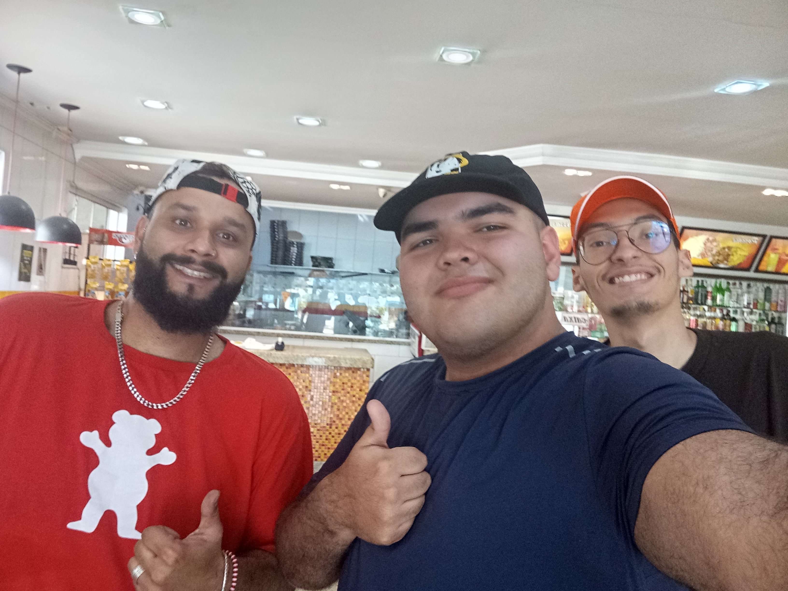
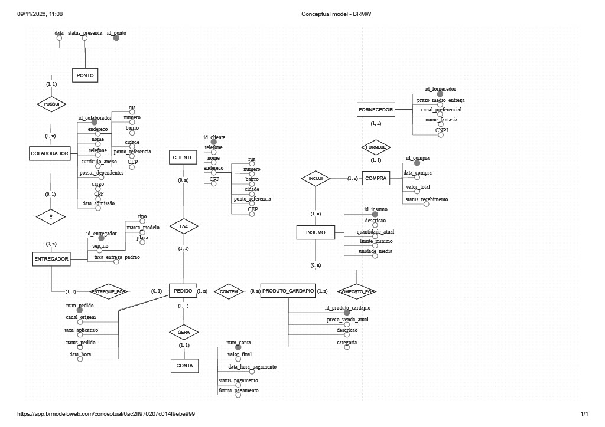

# 1\. Relatório Técnico Final

## Integrantes

| Nome completo do aluno | RGM | Usuário do Github |
 :---- | :---- | :---- |
 Matheus Nogales dos Santos | 47810629 | matheusnogales10-dev
 Carlos Eduardo Alves Lopes da Silva | 48465097 | jhonnysilverhand246-collab
 

## 1.1. Revisão do Modelo Conceitual

### 1.1.1. Caracterização da organização

- **Nome e natureza da organização:** Bar do Ernesto \- Restaurante e Pizzaria.  
- **Contexto e porte:** Organização de pequeno porte com fins lucrativos; 9 pessoas envolvidas na organização (sendo eles: colaboradores, entregador e o próprio dono); Cerca de 150 pedidos por semana.  
- **Problemas e necessidades identificados:** O restaurante muitas vezes se encontra sem o controle do próprio estoque; O estoque não possui organização; Funcionários e até o próprio dono, não possuem cargo fixo dentro das funções do restaurante, o único que possui cargo fixo é o chefe de cozinha.  
- **Escopo do Sistema:** O banco de dados desenvolvido aqui abordará as seções sobre os colaboradores da empresa, o estoque, o atendimento (tanto dentro do restaurante como por meio de entregas), o meio em que os produtos do estoque são fornecidos e os clientes.  
- **Justificativa da escolha:** O membro do grupo Matheus Nogales faz parte da familia do dono; O restaurante possui um tamanho razoavel para desenvolver um banco de dados sobre, ou seja, o restaurante não é de grande ou médio porte e nem possui franquias, o que faz dele um candidato perfeito para a realização do banco de dados.  
- **Evidências da organização:** R. Abel Tavares, 2470 \- Jardim Belem, São Paulo

### 1.1.2. Relato da entrevista

#### Identificação do Entrevistado e Participantes
* **Entrevistado:** William Nogales Santos
* **Integrantes do Grupo Presentes:** Carlos Eduardo Alves Lopes da Silva e Matheus Nogales dos Santos.
* **Data e Local:** 26/09/2026 — Realizada presencialmente no salão do Bar do Ernesto (Rua Abel Tavares, 2470 – Jardim Belém, São Paulo/SP).

#### Resumo da Entrevista e Observação no Local

* **Achados da Entrevista com o Proprietário:**
  * **Estrutura e Operação:** A equipe atual é composta por 9 funcionários no total. A operação engloba tanto o atendimento presencial no salão quanto o serviço de delivery.
  * **Canais de Venda e Entrega:** Os pedidos de entrega são recebidos por canais digitais (iFood e 99) e canais diretos (ligação telefônica ou WhatsApp). A logística de entrega conta com 1 a 2 motoboys fixos ou sob demanda.
  * **Dados e Identificação de Clientes:** O número de telefone do cliente atua como o principal identificador cadastral, vinculado obrigatoriamente ao endereço completo (regra obrigatória de que nenhum pedido ou cadastro prossegue sem endereço).
  * **Controle de Estoque e Compras:** Necessidade de monitoramento de itens e quantidades disponíveis, com alertas automáticos de reposição quando o limite mínimo crítico de estoque for atingido (ex: itens de alto giro). Os fornecedores são contatados por diferentes meios (aplicativo, WhatsApp ou ligação), exigindo o registro do canal de compra preferencial de cada fornecedor.
  * **Gestão de Pessoal e Funções:** Registro de dados dos funcionários (nome completo, telefone, endereço, currículo e dependentes), além de controle de presença/faltas e definição clara de cargos com checklist diário de atribuições.
  * **Expectativa de Sistema:** Um painel unificado e organizado que centralize a visão da operação, estoque, equipe e pedidos.

* **Achados da Observação Presencial:**
  * Observou-se na rotina diária a necessidade urgente de automatizar o controle de estoque que atualmente carece de organização, além de formalizar o fluxo de atendimento que transita entre comandas manuais e múltiplos aplicativos.

#### Comprovação da Visita Presencial
A foto comprobatória da entrevista e da visita realizada no estabelecimento encontra-se armazenada no repositório:
* **Foto com o Responsável:** 

#### Documentação Completa do Levantamento
O levantamento detalhado contendo a transcrição estruturada dos processos, formulários e regras operacionais observadas encontra-se em arquivo dedicado:
* **Documento Completo:** 

### 1.1.3. Processos de negócio

**Processos mapeados:** Cadastros de cliente; Recebimento de pedidos por canal; Atendimento no salão; Produção na cozinha; Entrega por Motoboy; Pagamento e fechamento de caixa; Gestão de cardápio; Compra de insumos e fornecedores; Recebimento de mercadoria Controle de Estoque; Cadastro de colaboradores e controle de ponto.

### 1.1.4. Requisitos

Requisitos funcionais | Requisitos não funcionais
 -------------------- | ------------------------- 
 **RF01** - O sistema deve permitir o cadastro de clientes informando nome completo, CPF, número de telefone e endereço completo (rua, número, bairro, complemento, ponto de refêrencia e cidade). | **RNF01** - Dados Sensiveís de clientes e colaboradores (como número de telefone e endereço) devem ser armazenados de forma segura e protegida contra acessos não autorizados.
 **RF02** - O sistema deve permitir o cadastro de colaboradores e entregadores registrando nome, telefone, cargo, documentos e dados de veículo (quando aplicável). | **RNF02** - As telas e consultas do sistema com dados operacionais não sensíveis devem carregar em um tempo inferior a 2 segundos.
 **RF03** - O sistema deve permitir a edição e atualização dos dados cadastrais de clientes, colaboradores e entregadores | **RNF03** - O sistema operacional de banco de dados deve manter uma disponibilidade de pelo menos 99% durante o horário de funcionamento do restaurante.
 **RF04** - O sistema deve permitir o registro de pedidos informando data/hora, canal de origem (iFood, 99, Whatsapp ou telefone), cliente associado e status atual.
 **RF05** - O sistema deve permitir compor o pedido utilizando itens do cardápio e produtos do estoque, registrando as quantidades e preços unitários praticados.
 **RF06** - O sistema deve permitir registrar as formas de pagamento e o status da quitação das contas associadas aos pedidos.
 **RF07** - O sistema deve permitir o controle de estoque de insumos, atualizando as quantidades automaticamente a cada venda ou entrada de mercadoria e disparando alertas quando atingir o limite mínimo.
 **RF08** - O sistema deve permitir o registro de fornecedores, seus prazos médios de entrega e os produtos fornecidos.
 **RF09** - O sistema deve permitir o registro diário de presença (ponto) dos colaboradores.

### 1.1.5. Regras de negócio

Código | Descrição
 ----- | --------- 
 RN01 | **Endereço obrigatório para entrega** - Nenhum pedido na modalidade de entrega pode ser finalizado sem o preenchimento completo do endereço de entrega (rua, número, bairro e ponto de refêrencia).
 RN02 | **Telefone como identificador do cliente** - O número de telofone/Whatsapp funciona como o principal elemento de identificação ágil do cliente no momento do atendimento.
 RN03 | **Registro obrigatório de canal de origem** - Todo pedido deve registrar obrigatoriamente a origem da venda (iFood, 99, Whatsapp ou Ligação Direta) para fins de repasse e estatística.
 RN04 | **Controle de estoque mínimo** - Quando a quantidade atual de um insumo atingir ou ficar abaixo do limite mínimo estabelecido, o sistema deve sinalizar a necessidade de reposição junto aos fornecedores.
 RN05 | **Vinculação de entregador e taxa** - Cada pedido de entrega deve ser associado a um entregador ativo, aplicando-se a taxa de entrega padrão correspondente à rota ou região.
 RN06 | **Formas de pagamento válidas** - Toda conta gerada a partir de um pedido deve possuir uma forma de pagamento válida registrada (dinheiro, cartão ou PIX) antes do seu fechamento definitivo.
 RN07 | **Conformidade com normas sanitárias** - Os insumos e produtos armazenados no estoque devem respeitar prazos de validade e padrões de controle de qualidade exigidos pelas normas de vigilância sanitária.

### 1.1.6. Notação do DER conceitual (Caso A)

## 1.2. Conversão do Modelo Conceitual para o Modelo Lógico

## 1.3. Definição de Chaves Primárias e Estrangeiras

## 1.4. Processo de Normalização

## 1.5. Justificativas Técnicas das Decisões

## 1.6. Proposta de Arquitetura Analítica para BI e IA

---

# 2\. Modelo Lógico Relacional

---

# 3\. Script SQL Completo

---

# 4\. Massa de Dados

---

# 5\. Uso de Inteligência Artificial

Ferramenta e etapa | Motivação | Prompt(s) utilizados | Resposta recebida | Fontes consultadas e verificadas | Trechos rejeitados ou corrigidos | Justificativa da escolha final | Reflexão crítica 
  ----------------- | --------- | -------------------- | ----------------- | ------------------------------- | ---------------------------- | ------------------------------- | ------------- 
  A IA Gemini foi utilizada na etapa de revisão do modelo conceitual. | IA foi utilizada para podermos agilizar o processo de mapear e corrigir requisitos, regras de negócio e processos, além de resumir a entrevista. | "Preciso fazer a entrega 2, para isso, eu quero que você, por enquanto, apenas preencha e corrija a seção sobre as regras de negócio e requisitos do readme que corresponde à entrega 2. Mantenha em mente o perfil do restaurante ao adicionar ou melhorar qualquer regra ou requisito, fique atento também ao issue, que é os erros que foram encontrados por um profissional." | "Com base no relatório de avaliação (issue.md), nas regras da Entrega 2 e no perfil do Bar do Ernesto (restaurante e pizzaria de médio porte com 9 colaboradores e cerca de 150 pedidos por semana), preparei as seções revisadas e aprofundadas para o README.md." | As fontes foram os documentos da entrega anterior | --- | A IA apenas foi utilizada como meio de agilização de processos, apenas para o grupo poder se preocupar com os documentos e programação em SQL. | A IA está sendo apenas utilizada como uma ferramenta, ela não substitui ninguém, pois ainda temos que verificar suas respostas.
